# JAK2 Curated Dataset

**Turning 56,323 raw public bioactivity records into a clean, documented, model-ready dataset —
using medicinal chemistry judgment to decide which measurements can be trusted and compared.**

Python · RDKit · pandas · scikit-learn · Matplotlib · ChEMBL · **Databricks** (PySpark, Delta Lake, Unity Catalog, MLflow, Jobs)

---

## Why this matters

Public bioactivity data cannot be used as downloaded. For a single target like JAK2, ChEMBL mixes
IC50, Ki, binding-kinetics and percent-inhibition data; the same compound appears as different salt
forms; some values are only limits (">10 µM"); mutant-enzyme and cell-based results sit next to
wild-type enzyme assays; and replicate measurements disagree.

Models or SAR conclusions built on that raw data are unreliable. This project resolves each issue
with an explicit, documented rule and records how many records every rule removed.

The pipeline is built twice: as a local Jupyter notebook (pandas), and as a production-style
**Databricks pipeline** (PySpark, Delta tables, lineage, MLflow, scheduled Job). Both produce identical
curated data ([section 7](#7-the-same-pipeline-on-databricks)).

## Pipeline

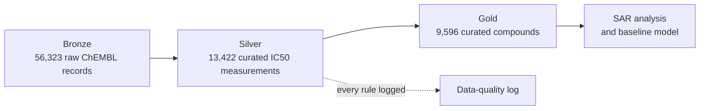

| Layer | Contents | Output |
|---|---|---|
| Bronze | Raw ChEMBL activity records, untouched | `data/raw/jak2_chembl_activities.csv` (66 MB, not committed; recreate with the export script) |
| Silver | Filtered, standardized measurements with pIC50 | `data/processed/jak2_silver_measurements.csv` |
| Gold | One row per compound: mean pIC50, spread, number of measurements | `data/processed/jak2_gold_compounds.csv` |
| Data-quality log | Rows removed by each rule, and why | `data/processed/jak2_dq_log.csv` |

---

## 1. What the raw data looks like

Only about a third of the raw JAK2 records are IC50 values. Most of the rest are binding-kinetics
(kon / k_off), Ki and single-point inhibition data, which measure different things and cannot be averaged together.

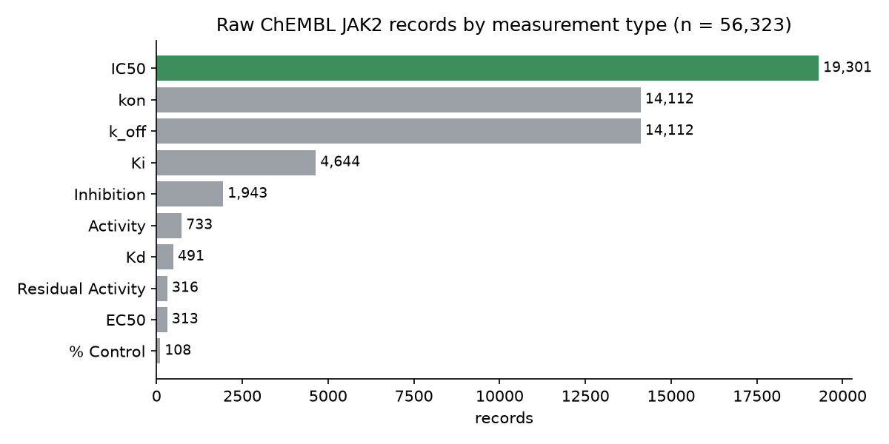

## 2. Curation funnel

Each bar shows what remains after one rule. Only about **24%** of raw records survive as comparable,
exact enzyme IC50 values. The rules and the chemistry behind them are in
[`docs/curation_rules.md`](docs/curation_rules.md).

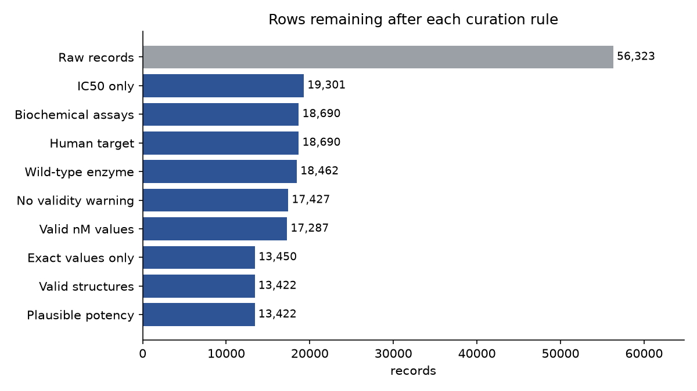

| Rule | Records removed |
|---|---|
| Not IC50 (Ki, kinetics, % inhibition, …) | 37,022 |
| Cell-based (functional) assays | 611 |
| Mutant enzymes (e.g. V617F) | 228 |
| Flagged by ChEMBL as likely errors | 1,035 |
| Missing or non-nM units | 140 |
| Censored values (">", "<"), set aside separately | 3,837 |
| Unparsable structures | 28 |
| **Curated measurements** | **13,422** |

## 3. Structure standardization

The same compound is often registered as a salt. RDKit strips salts and solvents, neutralizes charges,
and maps every record to its neutral parent structure, so all measurements of one compound line up.
The third example is **ruxolitinib phosphate**, the approved JAK1/2 inhibitor, correctly mapped to its free base.

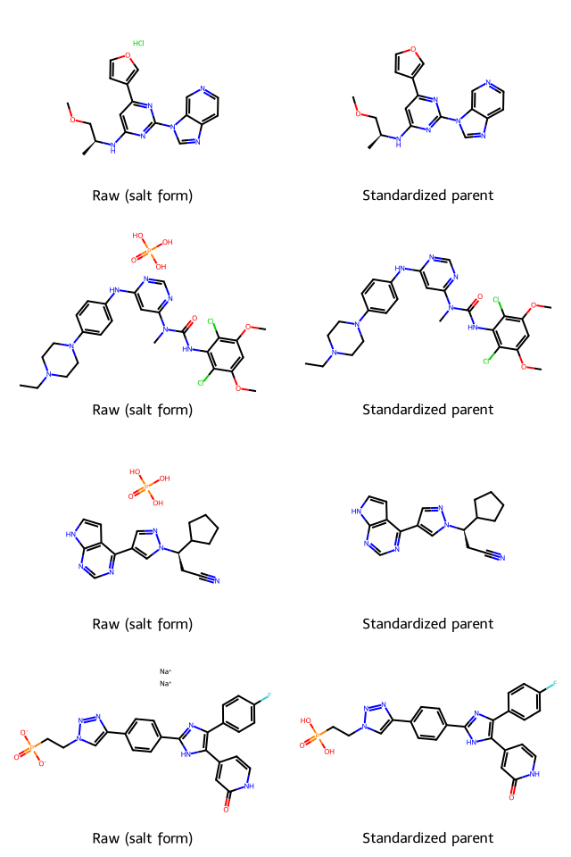

## 4. Replicate agreement

**2,361 compounds** were measured more than once. Replicates are averaged on the log (pIC50) scale.
Most agree within 0.5 log units (about 3-fold). **423 compounds** differ by more than 10-fold and are
**flagged rather than deleted**, so users can decide how to treat them.

The small cluster at almost exactly **3 log units (1,000-fold)** is the signature of unit errors, values
recorded in nM that were really µM or the reverse, which the flag catches.

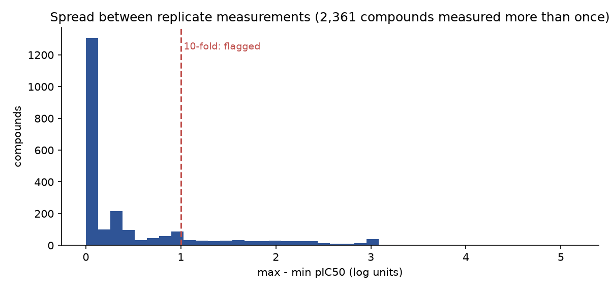

## 5. The curated dataset

**9,596 curated compounds.** Potencies center around pIC50 7–7.5 (roughly 30–100 nM), typical for
published kinase inhibitor data, which favors compounds that worked.

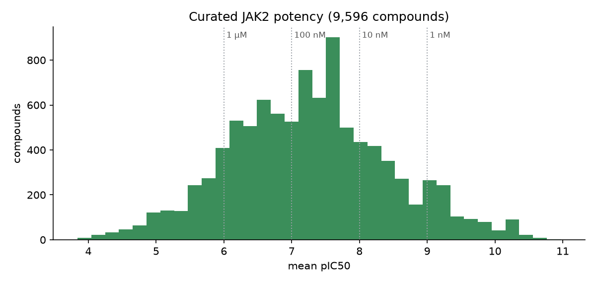

### Most common chemical series

The most frequent Bemis–Murcko scaffolds, with compound counts and mean potency.

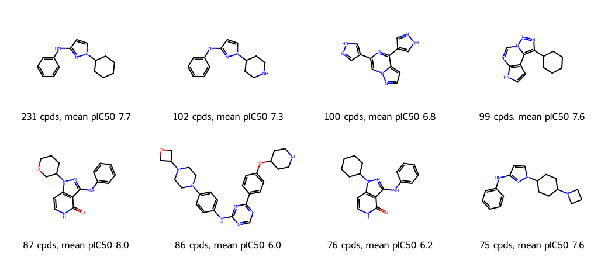

### Most potent curated compounds

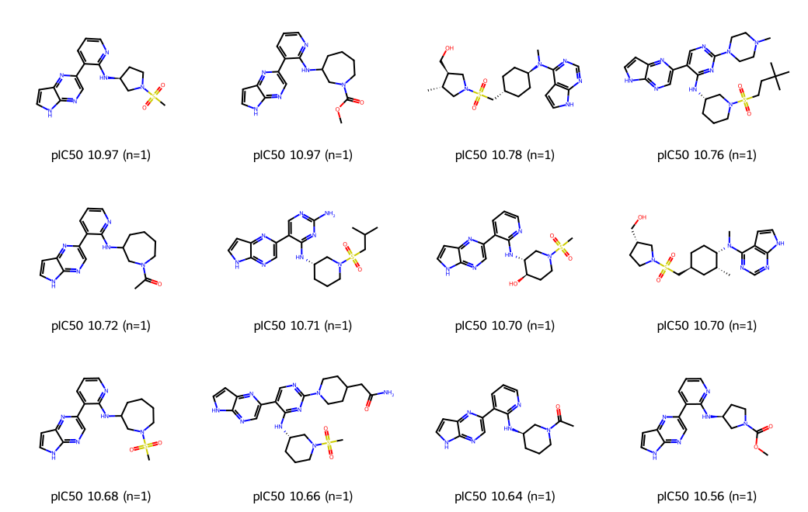

All of these were measured once (n = 1), with IC50 values around 10–25 pM, and most belong to a single
chemical series. Values this potent can sit at the sensitivity limit of the assay (tight binding), so they
should be read with caution. This series also explains the small bump near pIC50 10.3 in the distribution above.

## 6. Is the dataset usable? A baseline model

A Random Forest on Morgan fingerprints, evaluated with a **scaffold split**: the test set contains only
chemical series the model never saw in training, a stricter and more realistic test than a random split.

| Model | RMSE | MAE | R² |
|---|---|---|---|
| Random Forest (Morgan fingerprints) | 0.69 | 0.50 | 0.68 |
| Mean-value baseline | 1.23 | — | — |

Trained on 7,097 compounds, tested on 2,076 compounds from unseen scaffolds (the 423 flagged compounds
were excluded). A typical error of 0.5 log units means predictions are usually within about 3-fold of the
measured IC50. As is typical for Random Forest, predictions are pulled toward the middle: weak compounds
are slightly over-predicted and the most potent slightly under-predicted.

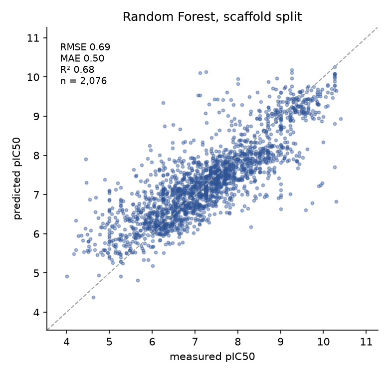

## 7. The same pipeline on Databricks

The curation was rebuilt in [`databricks/`](databricks/) as a medallion pipeline: raw ChEMBL data in a
Unity Catalog volume, **bronze → silver → gold Delta tables**, a data-quality log table, documented columns,
and a model tracked in **MLflow**. RDKit structure standardization runs inside Spark (`mapInPandas`), so
the work is distributed across the cluster.

**Same rules, same results.** pandas and PySpark produced identical curated data at every step:

| | Local (pandas) | Databricks (PySpark) |
|---|---|---|
| Raw records (bronze) | 56,323 | 56,323 |
| Curated measurements (silver) | 13,422 | 13,422 |
| Curated compounds (gold) | 9,596 | 9,596 |
| Flagged inconsistent | 423 | 423 |
| Model R² (scaffold split) | 0.68 | 0.68 |

Comparing the two implementations caught one subtle difference (rounding before the 10-fold check),
which was fixed so both agree exactly.

### One-click pipeline (Databricks Job)

Four notebook tasks run in sequence on serverless compute; the full rebuild takes about 10 minutes.

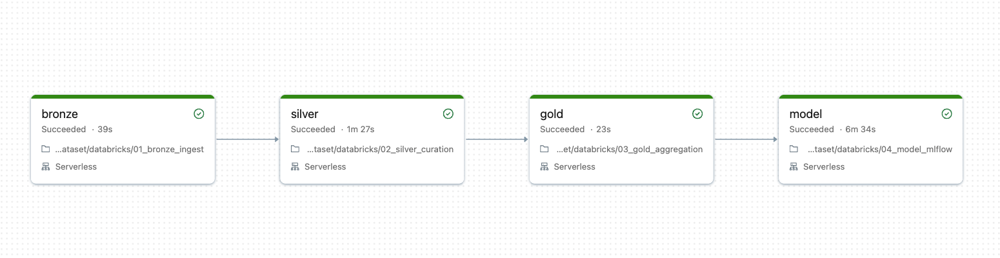

### Self-documenting gold table (Unity Catalog)

Every column of `gold_compounds` carries a description, and Unity Catalog links the table to the
notebooks and job that build and use it.

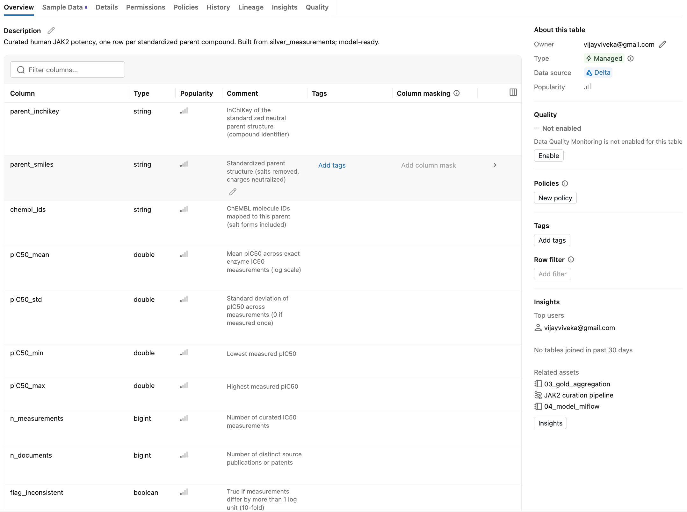

### Lineage: gold traced back to raw data

Unity Catalog records column-level lineage from `bronze_activities` through `silver_measurements` to
`gold_compounds`. (The two temporary volumes are from an earlier run, before the RDKit step was moved
inside Spark.)

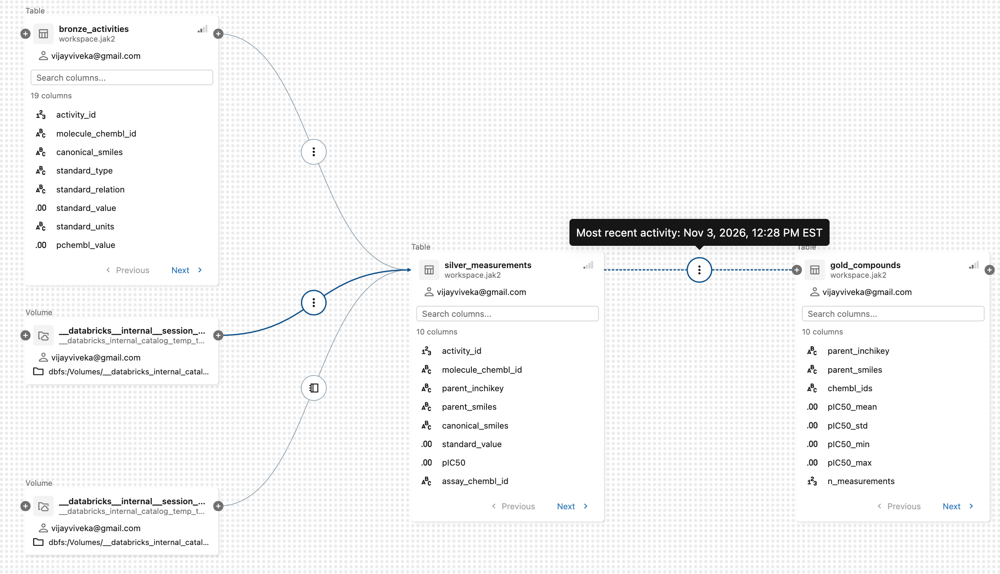

### Model tracked in MLflow

Parameters, metrics, the parity plot and the model are logged, together with the exact gold table
version used for training and the Job run that produced it.

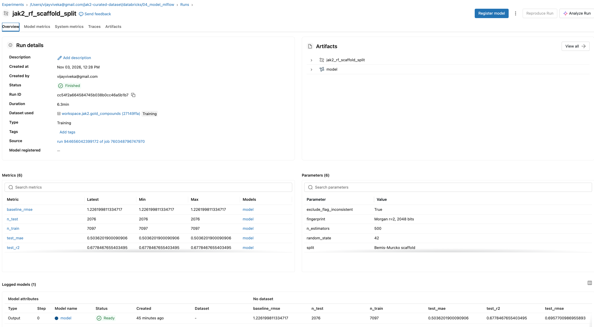

How to run it yourself: [`databricks/README.md`](databricks/README.md).

---

## How to run

```bash
conda create -n jak2 python=3.11 -y
conda activate jak2
pip install -r requirements.txt
python scripts/export_chembl_jak2.py              # downloads raw JAK2 data from ChEMBL
jupyter notebook notebooks/jak2_curation.ipynb    # run all cells; figures are saved to figures/
```

## Repository structure

```
jak2-curated-dataset/
├── scripts/export_chembl_jak2.py   # downloads raw ChEMBL data, with retries
├── notebooks/jak2_curation.ipynb   # bronze → silver → gold, data-quality log, figures, model
├── databricks/                     # the same pipeline on Databricks (PySpark, Delta, MLflow, Job)
├── data/raw/                       # raw ChEMBL export (bronze); created by the export script
├── data/processed/                 # curated datasets and data-quality log
├── figures/                        # figures used in this README (Databricks screenshots in figures/databricks/)
└── docs/curation_rules.md          # each curation rule and why
```

## Next steps

- Group IC50 values by ATP concentration (matters for ATP-competitive kinase inhibitors).
- Canonicalize tautomers.
- Add more endpoints as separate curated datasets: cellular IC50, Ki, and binding kinetics
  (residence time), in one long-format table with an `endpoint` column.
- Add automated data-quality expectations to the Databricks pipeline.

## Data source and license

Bioactivity data from [ChEMBL](https://www.ebi.ac.uk/chembl/) (EMBL-EBI).
Code is released under the MIT License. Curated data derived from ChEMBL is shared under CC BY-SA 3.0.
