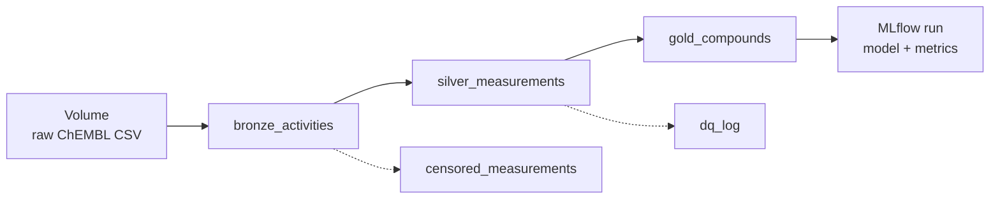

# JAK2 pipeline on Databricks

The same curation pipeline as `notebooks/jak2_curation.ipynb`, rebuilt as a Databricks medallion
pipeline: PySpark transformations, Delta tables in Unity Catalog, a data-quality log table, documented
columns, MLflow model tracking, and a scheduled Job that runs everything with one click.

| Notebook | Output |
|---|---|
| `00_setup` | Schema `workspace.jak2` and volume `workspace.jak2.raw` |
| `01_bronze_ingest` | `bronze_activities`: raw records, untouched, with ingestion metadata |
| `02_silver_curation` | `silver_measurements`, `censored_measurements`, `dq_log` |
| `03_gold_aggregation` | `gold_compounds`, with a description for every column |
| `04_model_mlflow` | MLflow run: parameters, metrics, parity plot, model, training-data lineage |

## How to run (Databricks Free Edition)

1. **Sign up** for Databricks Free Edition.
2. **Bring in this repo:** Workspace → **Create → Git folder** → paste
   `https://github.com/Vdevannah/jak2-curated-dataset` → Create. The notebooks appear under `databricks/`.
3. **Run `00_setup`** to create the schema and volume.
4. **Upload the raw data:** Catalog → workspace → jak2 → Volumes → raw → **Upload to this volume**,
   and select `data/raw/jak2_chembl_activities.csv` (created by `scripts/export_chembl_jak2.py`).
5. **Run `01` to `04`** in order, or create the Job below.

## Run the pipeline as a Job

Jobs & Pipelines → **Create job**, then add four notebook tasks:

| Task | Notebook | Depends on |
|---|---|---|
| bronze | `01_bronze_ingest` | none |
| silver | `02_silver_curation` | bronze |
| gold | `03_gold_aggregation` | silver |
| model | `04_model_mlflow` | gold |

Click **Run now**. The whole pipeline rebuilds from the bronze table in one run.

## What to look at afterwards

- **Catalog → workspace → jak2 → gold_compounds:** the column descriptions, sample data, and the
  **Lineage** tab, which traces gold back through silver to bronze.
- **dq_log table:** rows removed by each curation rule in the latest run.
- **Experiments:** the MLflow run with metrics, the parity plot, and the logged model.
